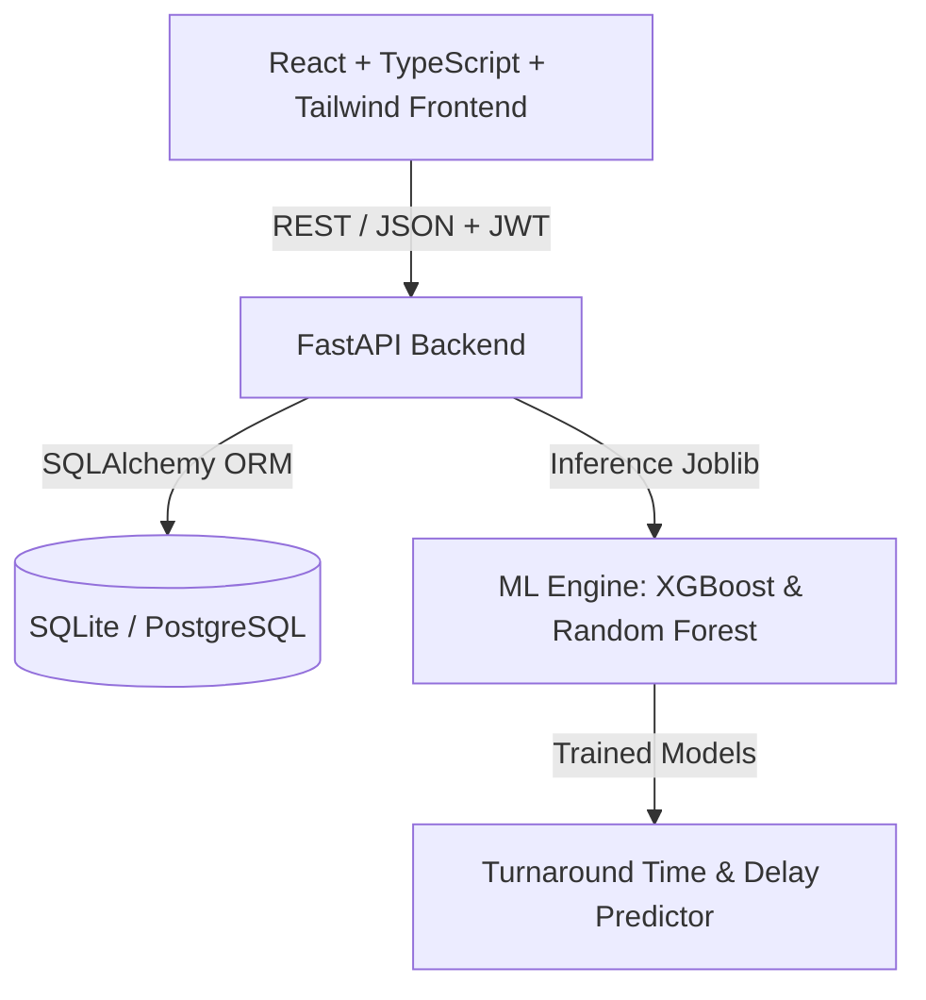

# PortPilot AI ⚓🚢

> **Next-Generation Maritime Port Logistics & Predictive Operations Engine**  
> Streamlining vessel traffic, berth allocation, quayside crane operations, and turnaround time predictions using Machine Learning.

---

## 📌 Overview

**PortPilot AI** is an enterprise-grade maritime port logistics management system designed for modern container terminals, harbour authorities, and shipping agencies. It bridges the operational divide between **Port Authorities** (Harbour Masters, Operations Directors) and **Shipping Agents** through automated scheduling, real-time yard & quayside tracking, and ML-powered vessel turnaround time forecasting.

---

## 🚀 Key Features

### 🏛️ Port Authority Operations
- **Real-Time Operational Dashboard**: High-level KPI monitoring (berth occupancy, quayside crane utilization, average wait times, active delays, and incoming vessel queue).
- **Interactive Berth Allocation (BAP)**: Visual berth scheduling, spatial constraints enforcement (LOA, beam, draft limits), and collision/overlap prevention.
- **Quay Crane Management**: Real-time crane allocation per vessel, load cycle tracking, maintenance logs, and health status indicators.
- **Yard Capacity Telemetry**: Yard block occupancy tracking, TEU heatmaps, dangerous goods (DG) zones, and reefer plug status.
- **Vessel Traffic & Pilotage**: Comprehensive vessel queue, tug and pilot assignment, draft checks, and arrival approval workflows.

### 🧑‍💼 Shipping Agent Portal
- **Arrival Pre-Notification & Request Filing**: Submit vessel specifications, cargo manifests, bunker requirements, and requested berthing windows.
- **Live Berthing Status**: Track vessel clearance, pilotage status, assigned berth, and crane allocation in real time.
- **Automated Reporting & History**: Digital cargo receipts, departure logs, and performance metrics.
- **Agent Profile & Agency Fleet Management**: Manage active agency vessels and communications directly with the port authority.

### 🧠 Machine Learning & Predictive Analytics
- **Turnaround Time Prediction**: Multi-model regression engine (XGBoost & Random Forest) estimating vessel port stay duration based on:
  - Container volume (TEU load/discharge)
  - Vessel gross tonnage, LOA, and draft
  - Assigned crane count and quayside congestion
  - Weather severity, wind speed, and tidal constraints
- **Explainable Predictions**: Real-time breakdown of turnaround factor weights, risk ratings, and confidence bounds.
- **Data Generator & Pipeline**: Automated synthetic AIS and terminal dataset generation for custom port topologies.

---

## 🏗️ Architecture & Tech Stack



- **Frontend**: React 19, TypeScript, Vite, Tailwind CSS, Lucide React, Recharts
- **Backend**: FastAPI (Python 3.10+), SQLAlchemy 2.0, Pydantic v2, Uvicorn
- **Authentication**: JWT (JSON Web Tokens) with Role-Based Access Control (RBAC) & Bcrypt password hashing
- **Database**: SQLite (default zero-config out-of-the-box) / PostgreSQL (enterprise ready)
- **Machine Learning**: Scikit-Learn, XGBoost, Joblib, Pandas, NumPy

---

## 📂 Project Structure

```
portpilot/
├── backend/                  # FastAPI Application
│   ├── auth.py               # JWT authentication & security utils
│   ├── database.py           # Database connection & session management
│   ├── main.py               # Core REST API endpoints & route handlers
│   ├── models.py             # SQLAlchemy ORM models
│   ├── schemas.py            # Pydantic schemas (validation & serialization)
│   ├── seed.py               # Mock data generator & initial database seeder
│   ├── schema.sql            # Raw SQL schema definition
│   ├── run_server.py         # Uvicorn launcher
│   └── requirements.txt      # Python dependencies
├── frontend/                 # React + TypeScript + Vite SPA
│   ├── src/
│   │   ├── components/       # UI components (MetricPanel, Navbars, Modals)
│   │   ├── context/          # React contexts (AuthContext, etc.)
│   │   ├── pages/
│   │   │   ├── agent/        # Shipping Agent views (Dashboard, Reports, Profile)
│   │   │   └── authority/    # Port Authority views (Dashboard, Berths, Cranes, Yard, ML)
│   │   └── App.tsx           # Route setup & role guards
│   ├── package.json
│   └── vite.config.ts
├── ml/                       # Machine Learning Pipeline
│   ├── data/                 # Training datasets
│   ├── models/               # Serialized trained models (.joblib)
│   ├── dataset_generator.py  # Synthetic port operations dataset generator
│   ├── predictor.py          # Real-time inference wrapper
│   └── train.py              # ML model training & evaluation script
├── docs/                     # Documentation & Architectural diagrams
│   └── figures/              # Generated plots and workflow schematics
└── START.bat                 # One-click Windows startup script
```

---

## ⚡ Quick Start

### Prerequisites
- **Node.js** (v18+)
- **Python** (v3.10+)

### Option 1: One-Click Startup (Windows)
Double-click `START.bat` or run:
```cmd
START.bat
```
This automatically boots:
- Backend server on `http://127.0.0.1:8000`
- Frontend dev server on `http://localhost:5173`
- Opens your default web browser to the login screen.

---

### Option 2: Manual Setup

#### 1. Backend Setup
```bash
cd backend
python -m venv venv

# Windows:
venv\Scripts\activate
# macOS/Linux:
source venv/bin/activate

pip install -r requirements.txt

# Seed sample data (optional if portpilot.db exists):
python seed.py

# Start the server:
python run_server.py
```
- API Docs: `http://127.0.0.1:8000/docs`

#### 2. Frontend Setup
```bash
cd frontend
npm install
npm run dev
```
- Web Application: `http://localhost:5173`

---

## 🔑 Demo Credentials

| Role | Email | Password | Access Scope |
| :--- | :--- | :--- | :--- |
| **Port Authority** | `authority@portpilot.ai` | `admin123` | Full access to Berth Allocations, Crane Telemetry, Yard, ML Predictions, and Approvals |
| **Shipping Agent** | `agent@portpilot.ai` | `agent123` | Vessel Arrival Declarations, Pilot Bookings, Live Status & Agency Profile |

---

## 📊 Machine Learning Model Retraining

To re-generate synthetic datasets and re-train the turnaround prediction models:

```bash
cd ml
python dataset_generator.py
python train.py
```
Models will be evaluated and exported into `ml/models/` (`xgboost_model.joblib`, `random_forest_model.joblib`, `best_model.joblib`).

---

## 📜 License

MIT License. Built for port operations optimization and intelligent maritime logistics.
